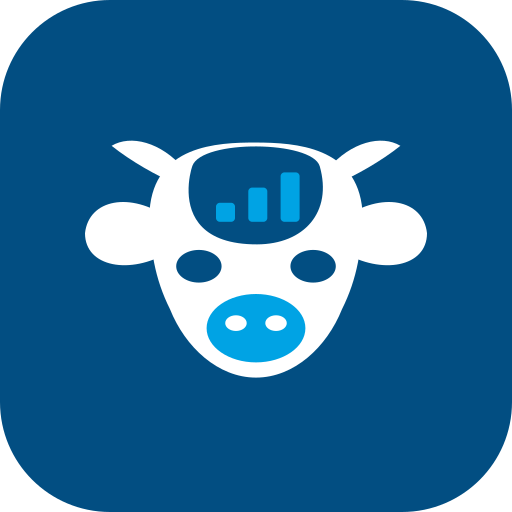

# bovidaeta

[](https://pypi.org/project/bovidaeta/)
[](https://pypi.org/project/bovidaeta/)
[](https://doi.org/10.5281/zenodo.24348211)
[](https://github.com/Bovi-Analytics/bovidaeta/blob/main/LICENSE)

**A common data format for dairy cattle data.**

Dairy data comes from many places: herd management software, milk recording
organizations, milking robots, activity sensors and vet records, each in its
own format. bovidaeta gives them one shape: **herds**, **cows** and a
timeline of **animal_events** per cow (calvings, milk recordings, diagnoses,
treatments, and so on). Code written against bovidaeta works for any farm
whose data has been converted to it.

bovidaeta is developed by the [Bovi-Analytics lab](https://bovi-analytics.org/)
at Cornell University.

## What's in the package

- **Data models**: [pydantic](https://docs.pydantic.dev/) models for herds,
  cows and events, plus typed metadata for each event type, so data is
  validated as you write it. Data from research studies fits in too:
  `Study` and `StudyAnimal` describe a study and its animals, and events
  record the study they came from.
- **Two storage formats**: one SQLite file per farm (on a laptop or an edge
  device on the farm), or Delta tables holding many farms (in Databricks).
  The table definitions ship with the package.
- **`DairyData`**: one loader for both stores, with filters for date range,
  event type, cows, herds and studies; so you don't need to write SQL.
- **Lactation helpers**: derive lactations and days in milk from the
  events.
- **A farm simulator**: generates a realistic-looking farm database, so
  you can try everything without real data.

## Installation

```bash
pip install bovidaeta
```

To read Delta tables outside Databricks, install the Spark extra (inside a
Databricks notebook, Spark is already there):

```bash
pip install 'bovidaeta[delta]'
```

bovidaeta supports Python 3.10 and newer.

## Quick start

### 1. Get some data

Don't have data in this format yet? Simulate a farm:

```bash
python -m bovidaeta.simulation --animals 200 --years 2 --db dairy_farm.db --seed 1 --yes
```

### 2. Load events

```python
from datetime import datetime, timezone

from bovidaeta import DairyData, EventType

data = DairyData.from_sqlite("dairy_farm.db")

milk = data.load_events(
    dts_start=datetime(2025, 1, 1, tzinfo=timezone.utc),
    subset_events=[EventType.MILK_RECORDING],
    subset_metadata=["milking_yield", "fat_percentage", "protein_percentage"],
)
print(milk.head())  # a polars DataFrame
```

`load_cows()`, `load_herds()`, `load_studies()` and `load_study_animals()`
work the same way. Use the filters: farm event tables get large fast.

### 3. Work with lactations

```python
from bovidaeta import load_lactation_records, load_lactations, select_lactations

lactations = load_lactations(data)
latest = select_lactations(lactations, "latest")
records = load_lactation_records(data, lactations=latest, max_dim=305)
```

Milk meter data can come as individual milkings and as daily totals.
`load_daily_milk_yields` gives one yield per cow per day from both, never
adding them up: daily totals by default, or measured milkings with
`prefer="milkings"`. `load_lactation_records(..., event_type=None)` attaches
those to lactations.

```python
from bovidaeta import load_daily_milk_yields

daily = load_daily_milk_yields(data, dts_start="2026-01-01")
```

### 4. Create records yourself

```python
from datetime import date, datetime, timezone
from uuid import uuid4

from bovidaeta import AnimalGender, Cow, Event, EventType, Herd, MilkRecordingMetadata

herd = Herd(herd_id=uuid4(), name="Example farm", country_code="US")
cow = Cow(
    animal_id=uuid4(),
    herd_id=herd.herd_id,
    gender=AnimalGender.FEMALE,
    birth_date=date(2021, 3, 14),
    exit_date=None,  # still on the farm
)
event = Event(
    event_id=uuid4(),
    event_type=EventType.MILK_RECORDING,
    animal_id=cow.animal_id,
    animal_id_source="1234",  # the cow's ID in the system the data came from
    datetime=datetime.now(timezone.utc),
    metadata=MilkRecordingMetadata(milking_yield=38.5, fat_percentage=4.1).model_dump(),
)
```

## Using Databricks (Delta Lake)

For many farms at once, bovidaeta data can live in Delta tables in Unity
Catalog:

1. Create the tables by running
   [`schemas/delta.sql`](https://github.com/Bovi-Analytics/bovidaeta/blob/main/src/bovidaeta/schemas/delta.sql) once in a SQL
   editor (set your catalog and schema at the top).
2. Load per-farm SQLite files into them with the
   [`pipelines/sqlite_to_delta.py`](https://github.com/Bovi-Analytics/bovidaeta/blob/main/pipelines/sqlite_to_delta.py) notebook.
3. Read them with the same loader:

```python
data = DairyData.from_delta("bovidaeta.farms")  # your catalog.schema
df = data.load_events(subset_events=[EventType.MILK_RECORDING])  # a Spark DataFrame
```

The filters are identical, but `from_delta` returns Spark DataFrames
instead of polars ones, so analysis code needs some changes when you move
between the two. `bovidaeta.to_polars()` converts a small Spark result to
polars. See [`src/bovidaeta/io/README.md`](https://github.com/Bovi-Analytics/bovidaeta/blob/main/src/bovidaeta/io/README.md) for
the details.

## Learn more

- [`src/bovidaeta/io/README.md`](https://github.com/Bovi-Analytics/bovidaeta/blob/main/src/bovidaeta/io/README.md): loading data,
  filters, and how the two stores differ
- [`examples/`](https://github.com/Bovi-Analytics/bovidaeta/tree/main/examples): runnable walkthroughs for SQLite and Databricks
- [`src/bovidaeta/simulation/README.md`](https://github.com/Bovi-Analytics/bovidaeta/blob/main/src/bovidaeta/simulation/README.md):
  the farm simulator
- [`src/bovidaeta/enums.py`](https://github.com/Bovi-Analytics/bovidaeta/blob/main/src/bovidaeta/enums.py) and
  [`event_metadata.py`](https://github.com/Bovi-Analytics/bovidaeta/blob/main/src/bovidaeta/event_metadata.py): every event type
  and its metadata fields
- [`schemas/`](https://github.com/Bovi-Analytics/bovidaeta/tree/main/src/bovidaeta/schemas): the SQLite and Delta table
  definitions, and migrations for databases created with an older version

## Repository layout

```
src/bovidaeta/
├── cow.py, herd.py, event.py,   data models
│   study.py, event_metadata.py,
│   enums.py
├── io/                          DairyData, one backend per store
├── lactation.py                 lactations and days in milk
├── schemas/                     SQLite and Delta table definitions, migrations
└── simulation/                  farm simulator
examples/                        runnable walkthroughs
pipelines/                       SQLite -> Delta load job (Databricks)
```

## Contributing

Contributions are welcome. See [CONTRIBUTING.md](https://github.com/Bovi-Analytics/bovidaeta/blob/main/CONTRIBUTING.md) to set up
a development environment and open a pull request.

## Citing

If you use bovidaeta in your research, please cite it using its DOI,
[10.5281/zenodo.24348211](https://doi.org/10.5281/zenodo.24348211), which always points to the latest release
(each release also has its own DOI on Zenodo). See
[CITATION.cff](https://github.com/Bovi-Analytics/bovidaeta/blob/main/CITATION.cff), or use "Cite this repository" on GitHub.

## License

bovidaeta is licensed under the [Apache License 2.0](https://github.com/Bovi-Analytics/bovidaeta/blob/main/LICENSE).
You're free to use it, including commercially. If you redistribute it,
include the [NOTICE](https://github.com/Bovi-Analytics/bovidaeta/blob/main/NOTICE) file, as the license requires.
